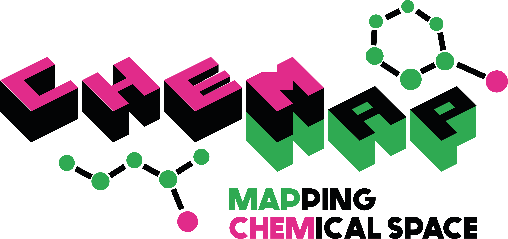

[](https://pypi.org/project/chemap/)

[](https://www.rdkit.org/)

# chemap - Mapping chemical space

Library for computing molecular fingerprint-based similarities and dimensionality-reduction-based chemical-space visualizations.

## Installation

`chemap` can be installed using pip:

```bash
pip install chemap
```

To include UMAP-based chemical-space visualization, install one of the optional CPU or GPU variants:

- CPU:

  ```bash
  pip install "chemap[cpu]"
  ```

- GPU with CUDA 12:

  ```bash
  pip install "chemap[gpu-cu12]"
  ```

- GPU with CUDA 13:

  ```bash
  pip install "chemap[gpu-cu13]"
  ```

## Fingerprint computations (choose from `RDKit` or `scikit-fingerprints`)

Fingerprints can be computed using generators from `RDKit` or `scikit-fingerprints`.

This includes popular fingerprint types such as:

### Path-based and circular fingerprints

- RDKit fingerprints
- Morgan fingerprints
- FCFP fingerprints
- ...

### Predefined substructure fingerprints

- MACCS fingerprints
- PubChem fingerprints
- Klekota-Roth fingerprints
- ...

### Topological distance-based fingerprints

- Atom pair fingerprints

## Fingerprint computations II (implementations in `chemap`)

Due to limitations in some existing implementations, `chemap` also provides its own fingerprint generators.

These can generate folded as well as unfolded fingerprints, each as either binary or count variants.

- MAP4 fingerprint → `from chemap.fingerprints import MAP4Gen`
- Lingo fingerprint → `from chemap.fingerprints import LingoFingerprint`

And, while not really a fingerprint in the classical sense, `chemap` also provides a simple element-count vector. This can be useful as a baseline for benchmarking tasks or as an additional component of a molecular representation.

The element-count fingerprint simply counts the number of H, C, O, etc. atoms:

- ElementCount fingerprint → `from chemap.fingerprints import ElementCountFingerprint`

Here is a code example:

```python
import numpy as np
import scipy.sparse as sp
from rdkit.Chem import rdFingerprintGenerator
from skfp.fingerprints import MAPFingerprint, AtomPairFingerprint

from chemap import compute_fingerprints, DatasetLoader, FingerprintConfig


ds_loader = DatasetLoader()

# Load a single dataset from a local file
smiles = ds_loader.load("tests/data/smiles.csv")

# Or load a dataset collection from a DOI-based registry (e.g. Zenodo)
files = ds_loader.load_collection("10.5281/zenodo.18682050")

# Pass one of the absolute file paths from files
smiles = ds_loader.load(files[0])


# ----------------------------
# RDKit: Morgan (folded, dense)
# ----------------------------
morgan = rdFingerprintGenerator.GetMorganGenerator(
    radius=3,
    fpSize=4096,
)

X_morgan = compute_fingerprints(
    smiles,
    morgan,
    config=FingerprintConfig(
        count=False,
        folded=True,
        return_csr=False,  # dense NumPy array
        invalid_policy="raise",
    ),
)

print("RDKit Morgan:", X_morgan.shape, X_morgan.dtype)


# -----------------------------------
# RDKit: RDKitFP (folded, CSR sparse)
# -----------------------------------
rdkitfp = rdFingerprintGenerator.GetRDKitFPGenerator(
    fpSize=4096,
)

X_rdkitfp_csr = compute_fingerprints(
    smiles,
    rdkitfp,
    config=FingerprintConfig(
        count=False,
        folded=True,
        return_csr=True,  # SciPy CSR
        invalid_policy="raise",
    ),
)

assert sp.issparse(X_rdkitfp_csr)
print(
    "RDKit RDKitFP (CSR):",
    X_rdkitfp_csr.shape,
    X_rdkitfp_csr.dtype,
    "nnz=",
    X_rdkitfp_csr.nnz,
)


# --------------------------------------------------
# scikit-fingerprints: MAPFingerprint (folded, dense)
# --------------------------------------------------
# MAPFingerprint is a MinHash-like fingerprint (different from MAP4 lib).
map_fp = MAPFingerprint(
    fp_size=4096,
    count=False,
    sparse=False,
)

X_map = compute_fingerprints(
    smiles,
    map_fp,
    config=FingerprintConfig(
        count=False,
        folded=True,
        return_csr=False,
        invalid_policy="raise",
    ),
)

print("skfp MAPFingerprint:", X_map.shape, X_map.dtype)


# ----------------------------------------------------
# scikit-fingerprints: AtomPairFingerprint (folded, CSR)
# ----------------------------------------------------
atom_pair = AtomPairFingerprint(
    fp_size=4096,
    count=False,
    sparse=False,
    use_3D=False,
)

X_ap_csr = compute_fingerprints(
    smiles,
    atom_pair,
    config=FingerprintConfig(
        count=False,
        folded=True,
        return_csr=True,
        invalid_policy="raise",
    ),
)

assert sp.issparse(X_ap_csr)
print(
    "skfp AtomPair (CSR):",
    X_ap_csr.shape,
    X_ap_csr.dtype,
    "nnz=",
    X_ap_csr.nnz,
)

# Optional: convert CSR -> dense if you need a NumPy array downstream
X_ap = X_ap_csr.toarray().astype(np.float32, copy=False)
```

## UMAP Chemical Space Visualization

`chemap` provides two functions for computing two-dimensional UMAP coordinates from molecular fingerprints:

- `create_chem_space_umap` uses `umap-learn` on CPU.
- `create_chem_space_umap_gpu` uses RAPIDS cuML on GPU.

Both functions use `chemap.compute_fingerprints` internally. Fingerprint semantics are therefore configured explicitly through `FingerprintConfig`. A caller-provided configuration is never silently modified.

### CPU UMAP

`create_chem_space_umap` supports both:

- `"tanimoto"` distance
- `"cosine"` distance

Tanimoto can be used with both folded and unfolded fingerprints. The appropriate dense or sparse Tanimoto implementation is selected automatically from `fingerprint_config.folded`.

The default fingerprint configuration is:

```python
FingerprintConfig(
    count=True,
    folded=False,
    invalid_policy="raise",
)
```

The default distance function is `"tanimoto"`.

Example:

```python
from rdkit.Chem import rdFingerprintGenerator

from chemap import FingerprintConfig
from chemap.plotting import (
    create_chem_space_umap,
    scatter_plot_hierarchical_labels,
)


data_plot = create_chem_space_umap(
    data_compounds,  # DataFrame containing SMILES and optional class metadata
    col_smiles="smiles",
    inplace=False,
    x_col="x",
    y_col="y",
    fpgen=rdFingerprintGenerator.GetMorganGenerator(
        radius=9,
        fpSize=4096,
    ),
    fingerprint_config=FingerprintConfig(
        count=True,
        folded=False,
        invalid_policy="raise",
    ),
    distance_function="tanimoto",
)

# Plot
fig, ax, _, _ = scatter_plot_hierarchical_labels(
    data_plot,
    x_col="x",
    y_col="y",
    superclass_col="Superclass",
    class_col="Class",
    low_superclass_thres=2500,
    low_class_thres=5000,
    max_superclass_size=10_000,
)
```

For folded fingerprints with cosine distance, for example:

```python
data_plot = create_chem_space_umap(
    data_compounds,
    col_smiles="smiles",
    fpgen=rdFingerprintGenerator.GetRDKitFPGenerator(
        fpSize=4096,
    ),
    fingerprint_config=FingerprintConfig(
        count=True,
        folded=True,
        invalid_policy="raise",
    ),
    distance_function="cosine",
)
```

### GPU UMAP

`create_chem_space_umap_gpu` uses RAPIDS cuML and is intended for substantially faster dimensionality reduction on supported GPU systems.

The GPU implementation has two important constraints:

1. The UMAP metric is fixed to `"cosine"`.
2. Fingerprints must be folded/fixed-size, i.e. `fingerprint_config.folded=True`.

The GPU function does **not** change a supplied `FingerprintConfig`. Passing an unfolded configuration therefore raises an error instead of silently converting it to a folded representation.

The default GPU fingerprint configuration is:

```python
FingerprintConfig(
    count=True,
    folded=True,
    invalid_policy="raise",
)
```

Example:

```python
from rdkit.Chem import rdFingerprintGenerator

from chemap import FingerprintConfig
from chemap.plotting import create_chem_space_umap_gpu


data_plot = create_chem_space_umap_gpu(
    data_compounds,
    col_smiles="smiles",
    inplace=False,
    x_col="x",
    y_col="y",
    fpgen=rdFingerprintGenerator.GetRDKitFPGenerator(
        fpSize=4096,
    ),
    fingerprint_config=FingerprintConfig(
        count=True,
        folded=True,
        invalid_policy="raise",
    ),
)
```

### Fingerprint scaling

Both CPU and GPU UMAP functions support optional fingerprint scaling through the `scaling` argument:

- `None`: use the fingerprint values unchanged.
- `"log"` or `"log1p"`: apply `log(1 + count)` scaling.
- `"tfidf"`: apply TF-IDF/IDF-based scaling.

Log scaling is only defined for count fingerprints and therefore requires:

```python
FingerprintConfig(
    count=True,
    ...
)
```

For example, a folded RDKit count fingerprint with log-count scaling and cosine UMAP can be computed on GPU as follows:

```python
from rdkit.Chem import rdFingerprintGenerator

from chemap import FingerprintConfig
from chemap.plotting import create_chem_space_umap_gpu


data_plot = create_chem_space_umap_gpu(
    data_compounds,
    col_smiles="smiles",
    x_col="x",
    y_col="y",
    fpgen=rdFingerprintGenerator.GetRDKitFPGenerator(
        fpSize=4096,
    ),
    fingerprint_config=FingerprintConfig(
        count=True,
        folded=True,
        invalid_policy="raise",
    ),
    scaling="log1p",
    n_neighbors=100,
    min_dist=0.25,
    umap_random_state=42,
)
```

The equivalent CPU calculation with cosine distance is:

```python
data_plot = create_chem_space_umap(
    data_compounds,
    col_smiles="smiles",
    x_col="x",
    y_col="y",
    fpgen=rdFingerprintGenerator.GetRDKitFPGenerator(
        fpSize=4096,
    ),
    fingerprint_config=FingerprintConfig(
        count=True,
        folded=True,
        invalid_policy="raise",
    ),
    scaling="log1p",
    distance_function="cosine",
    n_neighbors=100,
    min_dist=0.25,
    umap_random_state=42,
)
```

### Row alignment and invalid SMILES

Chemical-space coordinates are assigned back to the input DataFrame row by row. For this reason, both UMAP functions require:

```python
invalid_policy="raise"
```

This prevents invalid structures from being silently removed and ensures that every input DataFrame row corresponds to exactly one fingerprint and one UMAP coordinate.

### Reproducibility

Both CPU and GPU functions accept:

```python
umap_random_state=...
```

to control UMAP's random initialization where supported.

On the CPU path, note that `umap-learn` may restrict parallel execution when a random state is set. Use `n_jobs` according to the reproducibility/performance trade-off appropriate for your application.